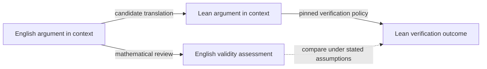
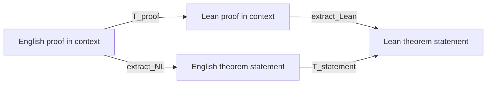
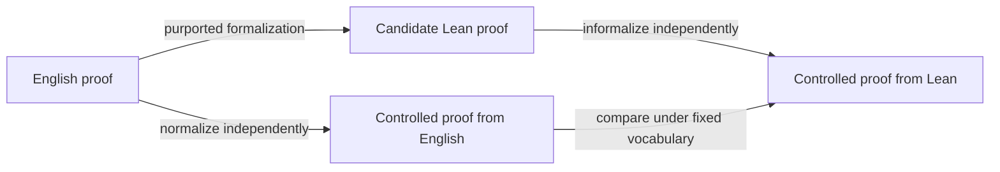

# Experiment: controlled language and path consistency

Added 2026-11-06. This experiment is separate from the direct correspondence
classifier in [methodology.md](methodology.md). It does not select a model or
claim that any translation path is already implemented.

## Hypothesis

An explicit controlled mathematical language may make assumptions, quantifier
scope, intermediate claims, and proof dependencies easier to compare than an
unrestricted English/Lean pair. The alternative hypothesis is that translation
loses relevant distinctions or adds errors and cost without improving detection.

The primary outcome remains detection of reviewed semantic mismatches, especially
those with valid Lean code. Path agreement is an additional feature and measured
outcome, not a replacement for ground-truth correspondence labels.

## ForTheL source and suitability

Andrei Paskevich, *The syntax and semantics of the ForTheL language*, December
2007: http://nevidal.org/download/forthel.pdf

The linked 70-page document was downloaded to `data/references/forthel.pdf` and
read locally. The web reader failed to fetch the HTTPS version; the original
HTTP link worked. The document describes:

- Preservation of distinctions among definitions, lemmas, and proof methods as
  part of mathematical discourse, beyond bare logical content (Section 1.1).
- Context-dependent, extensible vocabulary and potentially ambiguous syntax;
  unresolved ambiguous units are rejected in the described treatment
  (Sections 1.3 and 1.3.1). Controlled does not mean every sentence has an
  unambiguous intended meaning.
- Mapping statements to first-order formulas (Section 1.4).
- Structured sections, assumptions, choices/witnesses, claims, cases, and proofs,
  including induction and contradiction (Section 1.5).
- Distinct ontological correctness (well-defined uses in context) and logical
  correctness (claims justified by their predecessors) (Sections 2.1 and 2.3).

This is a plausible research intermediary, not just a request to an LLM to write
simpler English. Use a pinned implementation and documented vocabulary. Current
Naproche extends the older ForTheL dialect; record which dialect is used rather
than treating the 2007 grammar and a current parser as identical.

Related implementation sources:

- https://github.com/naproche/naproche
- https://naproche.github.io/download.html
- https://adelon.net/share/2021_IsabelleNaproche.pdf

The 2021 paper describes first-order translation and reports experiments in
translation to Lean, not a production bridge covering arbitrary Lean/Mathlib.
Naproche's presence in the Isabelle distribution does not make its output a Lean
kernel certificate. Parser acceptance, Naproche checking, and Lean checking are
three distinct results.

ForTheL's first-order treatment and Lean's dependent type theory require explicit
vocabulary and foundation mappings: e.g. numbers, equality, functions, sets,
coercions, and implicit assumptions. Begin with a restricted shared fragment.
Do not silently erase unsupported dependent types, type classes, or higher-order
structure. Mark unsupported cases and include their rate in the results.

## User's proposed dimension: argument validity

The user proposed language (NL versus FL) horizontally and correctness vertically,
associating incorrect English with failed type checking and correct English with
successful checking. This motivates testing validity preservation, but those
associations are not unconditional equivalences. Fidelity is assessed separately.

This is a proposed consistency test, not a proved commuting diagram. Independent
English validity assessment can be valid/invalid/uncertain. Lean outcomes include
verified/rejected/incomplete/environment failure; these status sets differ.

- Correct English can produce rejected Lean because of syntax, missing imports,
  a translation mistake, or incomplete elaboration.
- Incorrect English can accompany checking Lean if translation changes the claim
  or assumptions, replaces a flawed inference with a valid different argument,
  or an inadequate verification policy permits admissions or unapproved axioms.
- Agreeing validity verdicts do not prove faithful translation. Disagreement is
  evidence to investigate, not an automatic binary fidelity label.

A faithful complete formalization in a sound permitted environment provides
evidence for the corresponding English argument at the agreed granularity.
A rejected formal attempt does not prove its English source incorrect. Distinguish
a false claim from an invalid argument for a true claim: automation may prove the
latter claim by a different route without faithfully translating the argument.

If the vertical arrows instead mean **repair**, compare edits on both sides and
whether translation preserves their effect. That is a possible later experiment,
not an implemented feature; neither repair nor correctness assessment is a
canonical reversible transformation. Keep the initial classifier binary fidelity.

## Alternative diagram: language versus abstraction

NL-to-Lean-to-NL by itself is a cycle. A useful second axis is the transition
from a proof to its statement, including its full assumptions and context:

The proposed consistency condition is:

    extract_Lean(T_proof(p)) ≈ T_statement(extract_NL(p))

Here `≈` is an explicitly evaluated correspondence relation, not string equality
or a known theorem about our learned translators. Horizontal arrows change
representation; vertical arrows forget proof details. Supply the same source
context to both paths and independently produce the statement translation.
For an existing pair, use the supplied Lean proof as the top-right candidate;
the experiment tests whether that purported translation agrees with the other
path rather than assuming that it is a correct translation.

This square can reveal a changed conclusion, missing hypothesis, or altered
domain. It cannot establish argument fidelity: distinct proofs of the same
theorem can yield the same bottom row. The proof-to-statement map is lossy.

For argument fidelity, replace the bottom row with structured proof plans:
assumptions, intermediate claims, witness choices, induction/case structure,
and dependencies. Define the allowed granularity and ignored routine steps.
These plans are an experimental representation, not an automatically faithful
extraction of all Lean tactics or natural-language arguments.

## Diagram 2: independent controlled-language views

For an input pair `(n, f)`, produce `C_N(n)` from English alone and `C_F(f)` from
Lean alone, each with its appropriate definitions and context. Neither producer
sees the other member of the pair or its label. Compare the controlled outputs
under an explicit alignment of vocabulary and objects. The lower arrow denotes
a tested relation, not an assumed correct translator. This is a proposed
approximately commuting comparison square.

A complementary translation experiment compares the direct route
`NL -> Lean` against `NL -> ForTheL -> Lean`, with symmetric back-translation
where supported. Translate the statement and the proof plan separately when
possible so that statement agreement cannot hide a changed argument.

No correct/general ForTheL-to-Lean compiler is assumed. Initially these arrows
can be learned translations with measured errors; any kernel-checked bridge
must be implemented and justified for its supported fragment. For matching
ForTheL formulas, a failed equivalence proof/ATP timeout is unknown, not evidence
of nonequivalence. An independent countermodel can supply a stronger negative
where the logic and tool support it.

## Agreement criteria and limits

There are several distinct tests:

1. Text similarity or exact equality of controlled-language strings: cheap but
   not semantic equivalence; different strings can be equivalent.
2. Parser/grammar acceptance and scope-resolved abstract syntax: exposes
   structural differences under a fixed vocabulary; parsing alone does not prove
   intended meaning or correctness of a proof.
3. Normalized statement comparison: preserve binders, domains, assumptions,
   constants and definition mappings, with declared equivalence rules.
4. Proof-plan alignment: compare important intermediate claims and dependencies,
   allowing reviewed elaboration differences. It is not proof-term equality.
5. Independent checks of supported proof obligations in Naproche and Lean.
   Record their axiom policies and which obligations were actually checked.

Do not use Lean proof-term equality as the target for argument identity: Lean's
proof irrelevance makes that inappropriate for distinguishing arguments for the
same proposition. Likewise, proving `P ↔ Q` is insufficient evidence of faithful
translation on its own: two independently provable closed propositions yield
such a proof even when they express different claims. Preserve structure and
intended interpretations, not just mutual derivability in a strong library.

Lean reference for proof irrelevance:
https://lean-lang.org/doc/reference/latest/The-Type-System/Propositions/

Round-trip consistency (`back(forward(n)) ≈ n`) is useful but insufficient. Two
translators can share a systematic mistake and undo it on the return path, or
reconstruct familiar English while discarding proof structure. A ForTheL proof
can also be valid while expressing a different claim from its English source.
Human-reviewed labels and compile-passing counterexamples remain necessary.

## Controlled comparison

Use the same theorem-grouped splits and reviewed labels as the direct experiment.
Start with the 30-pair review pilot, then select a supported fragment covering
short proofs and report which original examples are excluded. Add vocabulary
definitions and source-span annotations to the review records. Do not require
the reviewers to trust the generated controlled text when assigning source labels.

Suggested arms:

| Arm | Judge input / procedure | What it tests |
| --- | --- | --- |
| A | Original English + Lean | Direct baseline |
| B | Independently normalized ordinary English views | Whether a second pass/normalization alone helps |
| C | Independently generated ForTheL views, text comparison | Effect of controlled wording without parser enforcement |
| D | Parser-validated ForTheL and structural/plan comparison | Added value of grammar and explicit structure |
| E | Original pair plus independent validated ForTheL views | Whether the intermediary helps without replacing source information |

Keep the same backbone/training budget where feasible. For B-E count all
translation calls, retries and tokens; include a direct baseline with comparable
inference budget. Pin prompts and generation settings, generate within split,
and keep all variants of a source theorem together. Avoid letting one pipeline
use labels, human corrections, or library context unavailable to the others.

Use two analyses: (1) automated end-to-end translations, where translation errors
count against the pipeline; (2) a small independently corrected intermediary
subset, to test whether the representation could help given a faithful
translation. Never mix the corrected-intermediary results into the automated
pipeline headline.

Metrics: statement/argument mismatch F1 and PR-AUC, false acceptance among valid
Lean candidates, calibration, and source-theorem bootstrap intervals. Also report
controlled-language parse rate, fragment coverage, verification success, timeout
rate, translation fidelity audits, latency, tokens, and any measured human review
time. Report both common-success-subset scores and full-pipeline coverage/risk;
do not discard parser failures and report only easier surviving examples.

Challenge cases should include quantifier order, hidden domain/coercion changes,
missing assumptions, changed witnesses, swapped induction/case steps, altered
intermediate claims, different valid proofs of the same theorem, and faithful
paraphrases. Include an information-loss test: does normalization collapse a
reviewed faithful pair and a nearby unfaithful variant to the same structure?

## Pilot decision

First manually map a small elementary fragment into actual ForTheL and confirm
parser acceptance with a pinned Naproche version. Then run the comparison arms
on a reviewed pilot. Broaden scope only if the bridge preserves the distinctions
we are measuring. Naproche/Isabelle has not been installed and no experimental
ForTheL-to-Lean bridge has been implemented as part of this design update.
