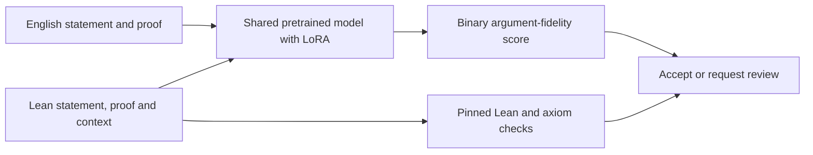

# Correspondence judge: current project plan

## Governing research question

Can we identify semantic differences between a natural-language mathematical
proof and its corresponding Lean proof? Every experiment serves this question.
As specified in `project-proposal-tbelcher.tex` and reaffirmed by the user on
2026-11-10, differences include changed assumptions, conclusions or argument
steps, even when Lean verifies the formalization. Routine formal elaboration and
equivalent presentations are allowed. Main evaluations and baseline comparisons
must compare English and Lean proof evidence, with justified or explicitly
assumed labels for semantic correspondence. Same-theorem alternative arguments
are an important test category, alongside other semantic changes.

English-only coherence tests are secondary controls. Their performance does not
measure cross-language semantic correspondence. Neither lexical similarity nor
Lean compilation alone answers the research question. For any new test, specify
the intended semantic change, label provenance, and what its metrics can establish
about the paired task. Unlabeled acceptance rates establish no semantic accuracy.
Retain the proposal's focus on false acceptance of unfaithful translations and
report mismatch precision/recall/F1, confusion matrices and semantic error cases
where labels support those claims.

## Execution status

2026-11-12: user authorized a source-balanced ProofNet/Faithform pilot to mitigate
source-label shortcuts. See SOURCE_BALANCED_PILOT.md for implemented32-row data,
provisional label evidence, grouped splits, secondary controls, and the32B runner.
Faithform local inference and ProofNet full-proof scopes must be reported separately.
No provisional label is human gold, and balanced source does not prove shortcut freedom.

Results reviewed2026-11-11: all8stages of the related-proof/intermediary queue
completedNovember10 at21:19 Eastern. See `RESULTS_2026-11-11.md`. New test
42/54original->53/54freshLoRA; old same-theorem diagnostic15/16->11/16. The four
original-model translation architectures ran, but their textual scores have
unequal coverage and no complete code-intermediary pair passed compilation.
Both dialect environments are built. Conditional generator fine-tuning was not
performed because no suitable paired dataset was found. Colibri research/planner
only; no larger-model inference. Earlier execution-status paragraphs are history.

New authorization, 2026-11-10 evening: execute the relatedness-threshold and
translation-intermediary comparisons in `OVERNIGHT_2026-11-10.md`. New grouped
train/validation/test splits, fresh original-model LoRA, and explicit synthetic
negative labels are planned; preparation resumed after a connection interruption.
The older candidate-review prerequisite is superseded by this authorization.
Data are frozen at366/60/54 training/validation/test rows and the eight-stage
background queue started17:53 Eastern. Smoke execution checks passed for all
four translation architectures; generated Lean validity is separately measured.
Check the new job artifacts before describing an individual stage as complete.

2026-11-10 follow-up: overnight14B run completed; results in
`RESULTS_2026-11-10.md`. A frozen-split lexical random forest baseline is now
completed. See `relatedness-and-baselines.md` for measured comparisons and the
mathlib dependency-graph approach to mining harder negatives. Graph/mining pilot
and frozen-model surveys are now completed; see `reports/relatedness-20261110/README.md`.
All365 extracted targets locally elaborate with isolated Lean4.28; candidates
remain unlabeled, and new hard-negative training is not performed. Earlier hold/run status
below is historical.

Last updated: 2026-11-10. This is the current research and experimental plan.
The first/second-pass statement experiment is now implemented and completed;
other methods below remain proposals unless explicitly recorded as implemented.
This is not an amendment to the submitted proposal. Qwen3-8B is the first model; this is
not a claim that it is the best-performing backbone.

## Current protocol after the 2026-11-09 audit

The corrected BF16 14B overnight run is complete. It used family-grouped data,
post-filter regenerated negatives, an English-only control and a compiled
same-theorem diagnostic with formal-proof masking. Read
[RESULTS_2026-11-10.md](RESULTS_2026-11-10.md) for measured results and
[PLAN_AUDIT_2026-11-09.md](PLAN_AUDIT_2026-11-09.md) for the audit history.
This does not turn the coarse swap task into a validated argument benchmark.
The user's ProofNet-positive assumption remains in force; no second pass was
included. The later relatedness graph/mining and forest Herald surveys are also
complete, with no new Qwen adaptation or trusted hard-negative labels.

| Experiment | Inputs / labels | State and permissible claim |
| --- | --- | --- |
| 8B statement matching | English/Lean statements; original audits plus corrected positives | Completed; report exact metrics with source-style confound and single-split limitations |
| 14B cross-problem proof consistency | Both proofs; assumed ProofNet positives and unrelated English proof swaps | Completed with corrected extraction/splits and English-only control; does not establish route matching |
| Same-theorem argument matching | Two valid English/Lean routes crossed into a 2x2 per theorem | Completed small agent-constructed diagnostic: four theorem families, 16 cases; independent review and expansion remain |
| Related-proof mining | Statement similarities and resolved mathlib dependencies; unlabeled proof-only and English-bundle swaps | Graph and frozen-model surveys completed; label review and lexical-only retrieval comparison remain |
| Herald survey | Untuned/tuned Qwen and two forests, no independent labels | Completed on 44,537 shared scored IDs; descriptive coverage and disagreement, not accuracy |
| Verbose Lean intermediary | Independently translated proof views, same reserved argument tests | Future representation comparison before generator reward optimization |

Current implementation uses constrained generative YES/NO token scoring with
LoRA. A separate classification head remains an optional architecture, not an
implemented component. The detailed earlier-stage descriptions below are history
unless explicitly retained by this audited protocol.

## Completed historical stage: two-pass statement experiment

Superseded as active work on 2026-11-09 by [argument-experiment.md](argument-experiment.md):
unquantized BF16 Qwen3-14B, both English/Lean proof bodies as inputs, user-assumed
corrected ProofNet argument positives, constructed proof negatives, untuned/tuned
comparison and Herald inference. No second-pass self-training in the new run.
Retain the completed statement experiment below as a separate reportable result.

The queued run completed 2026-11-07; Monday artifact review verified both adapters
and all evaluation stages. Frozen validation: untuned 62.50%, first pass 70.54%,
second pass 66.07%. Tuned mismatch detection is worse than untuned, despite higher
accuracy. Review errors and external input alignment before further adaptation.

The user has now authorized ProofNet-V LoRA training, original/first-pass Herald
comparison, agreement-only pseudo-label training of a fresh original Qwen, and
external IMO/OpenAI screening. See [two-pass-experiment.md](two-pass-experiment.md)
for the implemented protocol, measured first-pass results and limitations.
This is statement-fidelity supervision, not ground-truth argument labels; the
original argument-fidelity research target below remains distinct. The earlier
unlabeled-stage discussion below is historical and does not prohibit this new
authorized training experiment. Check `artifacts/two-pass/job.json` for live state.

### Earlier stage: proceed without manual labels

The user chose to defer reviewing the 30 sampled Herald pairs and proceed with
unlabeled work. Select/download the public `Qwen/Qwen3-8B` checkpoint, pin its
revision in `model-manifest.json`, and verify local GPU inference. Checkpoint
files live in ignored `data/models/Qwen3-8B/`.

Begin with zero-shot judgments and unlabeled corpus exploration; this does not
fine-tune weights. Keep model judgments separate from human ground truth and
do not report classification accuracy, calibration or validated confidence
without independently assessed labels. Manual review is not a prerequisite for
downloading and exploring the model.

If we later do unsupervised domain adaptation, define a concrete self-supervised
objective (e.g. causal language modeling on training-only text) first. It may
improve domain familiarity but does not directly teach the binary fidelity target.
Synthetic match labels would be weak supervision, not unsupervised learning.
Do not begin training or expose reserved evaluation families merely because the
checkpoint has been downloaded. Supervised binary fine-tuning remains a later
option, not the current immediate action.

For completed work and session context, read [SESSION_SUMMARY.md](SESSION_SUMMARY.md).
For actionable work and human/agent responsibilities, read [TODO.md](TODO.md).
The main baseline comes first; the linked experiments are extensions to compare,
not requirements that must all be implemented before the first training run.

A separate [controlled-language and path-consistency experiment](controlled-language-experiment.md)
compares direct judging with ForTheL intermediaries and develops the proposed
commuting diagrams. It retains the same binary fidelity target and grouped
splits, so its benefit can be measured independently of model selection.

The [external test plan](external-test-plan.md) reserves IMO problems and selected
OpenAI research manuscripts as distinct evaluation tiers, with explicit source
overlap checks and reviewed English/Lean alignment.

The [structured proof experiment](structured-proof-experiment.md) adds local
claim alignment, dependency/scope checks, and global judging, using candidate
lemma/proof-state extraction tools. It tests whether decomposing arguments helps
accuracy and error localization without assuming that matched pieces guarantee
a matched whole.

The user's [verbose Lean intermediary proposal](verbose-lean-experiment.md)
independently translates both source proofs into verbose Lean for argument
comparison, with future compilation/correspondence objectives. Tool references
are saved in [references.md](references.md). This remains future work.

## Research question

Can a learned judge detect semantic mismatches between natural-language
mathematics and Lean, especially when the Lean proof checks successfully?

The user confirmed the primary target: **faithful translation of the argument**.
The initial model has one binary output:

- **Yes:** same claim under equivalent assumptions, with the same essential
  argument. Routine elaboration, notation changes and elementary omitted steps
  are acceptable.
- **No:** a substantive statement or essential-argument discrepancy exists.
  A different valid argument for the same theorem is a negative.

`Uncertain` and `not assessable` are annotation statuses, not model classes;
exclude unresolved examples from supervised binary loss and evaluation. The
rubric is a checklist, not extra prediction heads. Record a rationale, source
evidence and optional mismatch category. Statement-only examples cannot supply
positive argument-fidelity labels without an English proof.

Keep three concepts distinct when assigning that single label:

1. **Formal validity:** Does the completed declaration check in the pinned Lean
   environment, with permitted axioms and no admitted goals?
2. **Statement correspondence:** Do the English and Lean statements agree on
   objects, assumptions, quantifiers, domains, and conclusion?
3. **Argument correspondence:** Does the Lean proof implement the English
   argument, allowing routine elaboration and automation but preserving its
   essential intermediate claims and dependencies?

A different valid proof of the same theorem is statement-matching and can be
argument-mismatching. Agreement of arguments is not canonical: the annotation
rubric must specify the tolerated level of detail. Label ambiguous cases
`uncertain`; do not force them to yes or no. If no English proof is available,
the argument label is missing, not negative.

## Proposed architecture

The implemented baseline trains YES/NO answer-token cross-entropy with LoRA;
a dedicated binary classification head is an optional future comparison.
Start with whole short proofs. Chunk matching, controlled-language intermediaries
and any multi-output model are optional experiments, not prerequisites.

The Lean result is computed, not predicted by the model. Report it separately.
An acceptance policy requires successful verification plus a fidelity score above
a validation-selected threshold; uncertain cases go to review.
Calibrate scores on validation data before describing them as probabilities.

Do not give the correspondence model compiler diagnostics or different compile
status distributions as a label shortcut in the primary semantic experiment.
Evaluate its discrimination on the compile-passing subset. A later diagnostic
experiment may deliberately include compiler feedback and report it separately.

## Decision-model comparison (proposed 2026-11-06)

The user suggested Jev. Its typed decision interface is relevant to the judge,
particularly focused questions about assumptions, domains, witnesses and aligned
proof steps. This is an optional baseline, not a selected model or implemented
integration. Keep Lean verification external to any learned decision model.

The linked `https://jevai.net/` identifies itself as an unofficial community
resource. Use TypeSafe's official documentation for access and model claims:
https://docs.typesafe.ai/models
https://docs.typesafe.ai/introduction/machine-learning-primer

Official docs describe Jev as a hosted model with typed decisions and probability
outputs, not customer-specific LoRA/fine-tuning. Therefore it is a candidate
hosted baseline rather than our local fine-tuning backbone. Vendor calibration
claims do not establish calibration on English/Lean correspondence.

Candidate experiment: evaluate a pinned Jev version on the same human-reviewed
development/test pairs as the open-model baselines, with a binary fidelity
question and optional diagnostic chunk questions. Tune prompts/thresholds
only on development data. Compare mismatch recall, false acceptance, Brier score,
reliability, coverage, latency and cost. Do not use Jev answers as ground truth.
It does not generate free-form rationales; source-evidence explanations must be
produced/reviewed separately. No Jev requests or signup have been performed.

An open decision-model candidate is Cloudflare's Clef-Flash, a 9B model based on
Qwen3.5-9B with typed-option scoring and released weights under Apache 2.0:
https://huggingface.co/Cloudflare/clef-flash
Its custom model/head and local training compatibility must be checked before
selection; published general-purpose benchmarks do not establish Lean fidelity.
No checkpoint was downloaded. Qwen3-8B/Goedel remain the provisional comparison,
with Clef-Flash an additional candidate to assess rather than a committed switch.

Our proposed classification head already implements a related idea: map evidence
directly to label scores without requiring generated prose. Begin with supervised
cross-entropy and validation-based calibration. Do not assume reproducing a
decision interface reproduces TypeSafe's proprietary training recipe or that
reinforcement learning is necessary for a useful calibrated classifier.

## How compilation can participate in a reward

For a fixed input pair, Lean success is independent of a classifier's yes/no
answer. Simply adding a compilation bonus to that classifier's reward cannot
teach it correspondence. Supervised correspondence labels are the first step.

For a **generator** that proposes Lean code, both quantities can affect reward.
Let V be 1 only if the candidate satisfies the verification policy; let F be
a frozen judge's calibrated binary argument-fidelity score. One illustrative
objective is:

    R(candidate) = -1                         if V = 0
                   F                         if V = 1

These values are proposed design
choices, not validated hyperparameters. A validity gate prevents a high learned
score from compensating for an invalid proof. Use an abstention threshold for
acceptance, not just the largest reward among bad candidates.

Start by ranking a fixed candidate set using compiler-only, judge-only, and
gated combined scores. This tests whether the judge adds value without online
RL. Only then consider SFT followed by GRPO with a custom verifier/judge reward.
The judged generator and judge should be independently evaluated; freeze the
judge during optimization and use human-reviewed held-out candidates to detect
reward exploitation. A model cannot supply its own trustworthy match labels.

Generation expands the original project's scope and runtime cost. It is a
second experiment, not a prerequisite for training the proposed reviewer.

## Dataset recommendation

### Primary formal source: Mathlib and its human-written documentation

Include Mathlib directly as a curated source, in addition to the synthetic
Herald pairs derived from it. Community review, explicit formal context, and
checked proof bodies make it a strong foundation for constructing the dataset.
Many declarations also have human-written English docstrings; some files contain
longer mathematical exposition and proof comments. These are valuable paired
materials, but their granularity must be assessed rather than assuming every
declaration has a full aligned English proof.

Source: https://github.com/leanprover-community/mathlib4
Documentation requirements:
https://leanprover-community.github.io/contribute/doc.html

Use the already downloaded Mathlib snapshot
`20c73142afa995ac9c8fb80a9bb585a55ca38308` (v4.11.0), with its original
dependencies. Record source paths, declaration names, source spans, docstrings,
proof bodies, imports, definitions and section/namespace context. Later snapshots
can form a separate versioned experiment; do not silently mix Lean environments.

Distinguish three data sources in the experiment records:

| Source | Appropriate correspondence target | Label treatment |
| --- | --- | --- |
| Human-written declaration docstring + formal statement | Statement correspondence | Strong candidate positive; review assumptions and scope |
| Human-written proof exposition/comments + formal proof | Argument correspondence where explicitly aligned | Review completeness, granularity and source alignment |
| English generated from a Mathlib declaration/proof | Statement and/or argument correspondence | Synthetic candidate; audit and retain generator provenance |

A statement docstring is not an English proof. Missing proof exposition means an
unavailable argument label, not an argument mismatch. API comments, implementation
notes and theorem aliases should not be treated as mathematical proof narratives.
Lean checking validates formal declarations, not the meaning of their docstrings.

Concrete inspected example: `Mathlib/Data/Nat/Prime/Basic.lean` contains the
docstring and complete proof for `Nat.exists_infinite_primes`. The docstring
describes an arbitrarily large prime; the proof uses the least prime factor of
`n! + 1`. This gives a statement-alignment seed. A faithful factorial-based English
proof could be independently written and reviewed for argument labels, but the
brief existing docstring must not be presented as that full proof. Also inspected:
`Mathlib/NumberTheory/Basic.lean` includes an English description of
`dvd_sub_pow_of_dvd_sub` together with its formal declaration and proof.

For the pilot, prioritize human-documented Mathlib examples and compare them
against reviewed Herald pairs. A small human-reviewed, documented subset can
anchor evaluation while a larger synthetic subset supplies training candidates.
Use an independent human-authored exposition where possible to measure transfer
away from English produced by reading Lean code.

**Important overlap rule:** Herald is generated from Mathlib, so these are not
independent corpora. Assign every Mathlib theorem, its docstrings, generated
English, proof variants and controlled-language views to the same split. Match
by source identity and normalized declaration, not just row IDs; check aliases,
related lemmas and dependency/source-file clusters too. A Mathlib-docstring test
set is contaminated if its Herald rendering was used in fine-tuning. Base-model
exposure to public Mathlib remains a separate limitation.

### Training corpus candidate: Herald Proofs

- Source: https://huggingface.co/datasets/FrenzyMath/Herald_proofs
- Pinned revision: `2d31b459df74d730bff85682de237d894b4eecfa`
- Dataset card: Apache 2.0; 44,553 rows; Lean 4.11.0.
- Observed fields: `id`, `name`, `formal_theorem`, `informal_theorem`,
  `formal_proof`, `informal_proof`, `commented_proof`, `header`.
- The English is generated from Mathlib; pairs are candidate positives, not
  manually certified correspondence labels.
- The observed `formal_theorem` field includes `:= by sorry` templates. Use
  `header` plus the completed `formal_proof` for proof verification, not that
  statement template. `formal_proof` already includes the declaration.
- Exclude `commented_proof` from judge inputs: its English annotations can leak
  the answer or create a trivial text-overlap signal.
- Compilation must be checked in the dataset's original context and pinned
  Mathlib revision. A release tag is the initial environment; record failures
  and investigate the exact source commit before labeling them invalid.
- Imported Mathlib can already contain the target theorem. Renaming a replayed
  declaration avoids duplicate-name errors but does not stop circular shortcuts.
  For generator evaluation, restrict the environment/dependencies so the original
  result cannot simply be invoked to prove itself.

Paper and release code:
https://arxiv.org/abs/2410.10878
https://github.com/frenzymath/herald_translator

Run `scripts/audit_herald.py` to download this revision, audit structural quality,
produce 30 reproducibly sampled **unlabeled** review records, and prepare a small
Lean replay probe. The report does not certify semantics or proof integrity.

Observed local audit: 44,553 rows, no null/empty required text fields, no duplicate
theorem names or identical full formal proofs. All 44,553 statement templates
contain admission-token candidates; none of the completed formal proofs contain
the scanned admission tokens. This lexical scan does not inspect transitive
axioms. A renamed replay of row 0 compiled under Mathlib revision
`20c73142afa995ac9c8fb80a9bb585a55ca38308`; its printed axioms were `propext`
and `Quot.sound`. The rest of the corpus has not been replayed.

The downloaded Parquet SHA-256 is
`4b60fe33b7818d21d4d8e880adf3f9704fd1b5f5553eb3a03fc36bc8db9d5c29`.

### Other candidates and their role

- **ProofNet:** 371 original examples with English statements/proofs and Lean 3
  statements. A Lean 4 port exists, but it is principally a statement benchmark;
  do not assume complete aligned Lean proof bodies. Use manually audited
  statement pairs as an external-domain evaluation source, not the main proof
  fidelity training set. It is public and may appear in base-model training.
  https://arxiv.org/abs/2302.12433
  https://github.com/rahul3613/ProofNet-lean4
- **Lean Workbook:** about 57k formal/informal problem pairs with proofs where
  available. Useful for statement matching and contest-math coverage; inspect
  actual rows before asserting paired English/Lean proof coverage.
  https://huggingface.co/datasets/internlm/Lean-Workbook
  https://arxiv.org/abs/2406.03847
- **Compfiles:** a candidate source for a small human-reviewed evaluation set.
  Audit each entry for English proof availability and whether its Lean proof
  follows the same argument. https://dwrensha.github.io/compfiles/imo.html

The user has authorized assuming corrected ProofNet proof pairs are argument
positives. Keep that assumption distinct from a published binary argument audit.

## Labeling and construction

The original 30-pair manual review was deferred by the user and is not a current
prerequisite. Use the authorized ProofNet-positive assumption, correct extraction,
and establish a small same-theorem argument test with transparent construction
provenance. Broader weak-label scale-up and a final reviewed test remain later
work. Never tune prompts, transformations, thresholds or models on a final test.

For each example retain source/revision, original theorem identity, complete
context, English statement/proof, Lean declaration/proof, transformation type,
reviewer rationale, binary fidelity label, review status, verification status,
and axioms. Optional diagnostic tags describe the mismatch.
Record source split and any synthetic-generation provenance.

Include:

- Reviewed faithful pairs and meaning-preserving paraphrases.
- Statement negatives: changed domain, quantifier, assumption, boundary case,
  or conclusion. Check that the edit changes meaning rather than merely wording.
- Argument negatives: the same statement with a genuinely different valid proof,
  or an altered English intermediate claim inconsistent with the unchanged Lean
  proof. Review whether the difference is essential under the rubric.
- Compile-passing negatives: retain the valid Lean code and change the English
  meaning. This directly prevents compilation from solving the classification.
- Separate broken-code controls, labeled with correspondence only when there is
  enough meaning to judge it; do not label every syntax failure as mismatch.
- Hard positives, including equivalent notation and routine proof compression,
  to avoid learning that every surface difference means mismatch.

Remove theorem-identifying English comments from model inputs. Balance mutation
styles across labels; include human-written examples so synthetic artifacts do
not become the decision rule. Have a second qualified reviewer label a subset
independently and report agreement and adjudication.

## Splits and evaluation

Split original theorem families before making variants or paraphrases. Group
duplicates and closely related source files/lemmas where possible; recover source
file metadata from pinned Mathlib because Herald rows do not directly supply it.
Use a topic/source holdout for a stronger generalization check. Check overlap
with all external benchmarks; public data exposure in pretraining remains a
limitation even after clean fine-tuning splits.

Report mismatch precision, recall, F1, PR-AUC, confusion matrices, and false
acceptance among compile-passing mismatches. Break errors down by optional
statement/argument tags. Report Brier score/reliability plots, abstention coverage, and
performance by mismatch type, source, and proof length. Bootstrap by source
theorem, not by individual mutated row. Keep the independent theorem count clear.

Compare TF-IDF/logistic regression, unfine-tuned LLM judgments, one-head LoRA,
and the same judges with the deterministic validity gate. For a
generator extension compare compiler-only ranking with compiler-plus-judge
ranking on the same candidates and manually review accepted outputs.

## Verification policy

Lean success alone permits `sorry` warnings and does not establish fidelity.
Require no admitted goals, check the target declaration's transitive axioms,
reject `sorryAx` and unapproved added axioms, and explicitly allow the standard
axioms appropriate to the experiment. Pin imports and prohibit candidate changes
to the trusted environment. Use timeouts and resource limits for generated code;
timeouts/environment failures are separate from mathematical invalidity.

Reference: https://lean-lang.org/doc/reference/latest/ValidatingProofs/
TRL custom rewards: https://huggingface.co/docs/trl/grpo_trainer

The included smoke tests and replay probes validate installation and a sample
compilation only. They do not implement the production verification policy.
