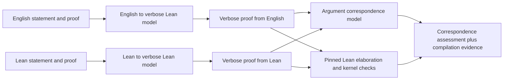

# Future experiment: compare independent verbose Lean proof views

User proposal recorded 2026-11-09. Future work after the direct proof-body
experiment; no implementation, installation or performance result is implied.
References: [verbose-lean4](https://github.com/PatrickMassot/verbose-lean4) and
[natural_lean](https://github.com/medovina/natural_lean).

## Proposed architecture

Generate a verbose Lean proof from the English argument and another verbose
Lean proof from the original formal argument. Compare those views to predict
whether the source arguments correspond. This is a Lean-native alternative to
the ForTheL intermediary proposed in `controlled-language-experiment.md`.

The two translations may use a shared backbone with task-specific adapters or
separate models; this is undecided. In the primary test each translator receives
only its own source proof and required definitions/context, preventing it from
rewriting its output to agree with the other branch. Retain original sources
for comparison and provenance.

The intermediary should expose assumptions, introduced objects/witnesses, local
claims, case splits, dependencies and conclusion. Compare aligned steps and
dependencies as well as the whole proof, allowing notation and bound-variable
renaming. Matching text is a baseline, not the definition of argument equality.
Lean proof-term equality or merely proving the same proposition does not certify
that the arguments follow the same route. Avoid normalizing different arguments
into one canonical proof, which would erase the signal we are trying to detect.

## Compilation and correspondence objectives

For a future generator/custom architecture, consider training on faithful
translations and using actual compiler/axiom checks plus a separately evaluated
correspondence judge for candidate selection or later reward optimization.
Compilation is an external check, not a differentiable classifier loss or a
substitute for argument agreement. A candidate acceptance/ranking policy can gate
on successful verification and then use correspondence scores; source-preservation
checks should also constrain each translation branch.

Begin with fixed candidate generation and ranking, comparing compiler-only,
correspondence-only and combined policies before introducing online reinforcement
learning. A learned judge's score is not independent ground truth. No reward
coefficients, shared encoder design, training objective or RL method is finalized.

## Evaluation and first pilot

1. Inspect/pin one dialect and its compatible Lean/Mathlib environment; keep it
   isolated from existing corpus environments. Test actual parser/elaborator
   acceptance rather than calling arbitrary verbose-looking text valid Lean.
2. On a small reserved proof-body subset, independently generate both views,
   record source spans and dependencies, and assess whether each preserves its
   own input argument. Keep translation failures as explicit unknowns.
3. Compare direct proof judging, verbose-text similarity, verbose structured
   alignment and original-plus-verbose judging on the same source-family splits.
4. Include different valid arguments for the same theorem, meaning-preserving
   presentation changes and incorrect English with repaired formal proofs.
   Report correspondence metrics separately from compilation rate and coverage.

Current status: references and proposal saved only. The running unquantized
Qwen3-14B direct proof-body experiment is not modified by this future-work item.
